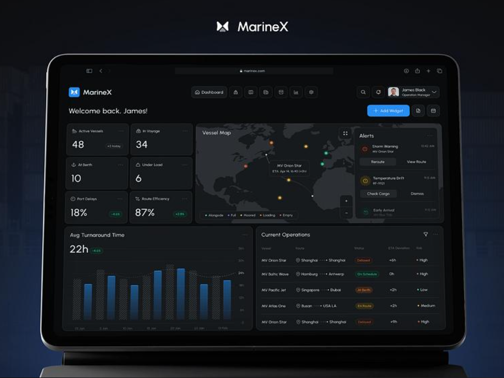
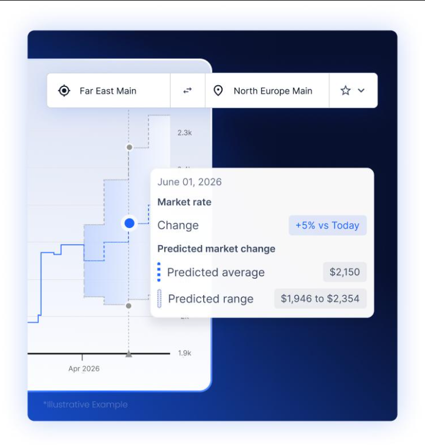
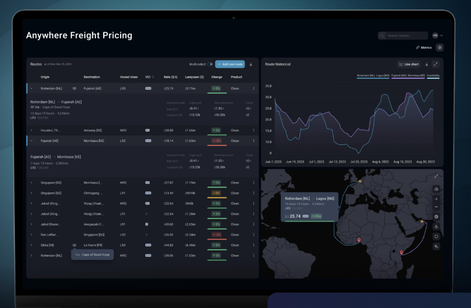
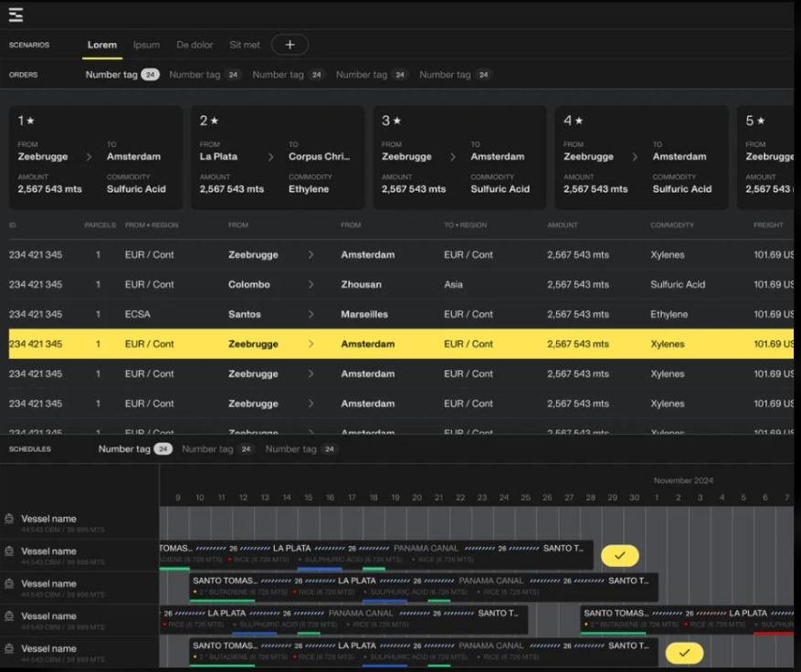
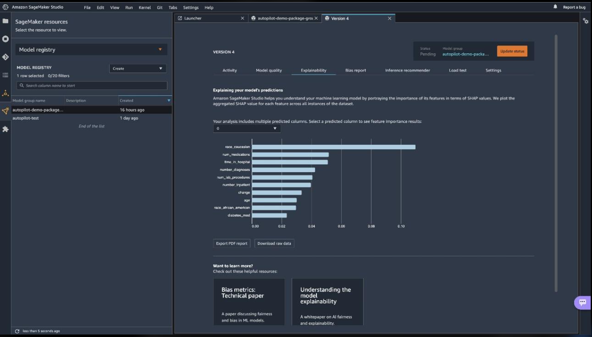

# FreightAI — Intelligent Freight Forecasting & Vessel Chartering System

<div align="center">



**Smart India Hackathon 2026 · Problem Statement P23 (SIH26006)**

[](https://fastapi.tiangolo.com/)
[](https://react.dev/)
[](https://www.typescriptlang.org/)
[](https://xgboost.readthedocs.io/)
[](https://www.python.org/)
[](https://tailwindcss.com/)

</div>

---

## Table of Contents

1. [Problem Statement](#problem-statement)
2. [Project Overview](#project-overview)
3. [Key Features](#key-features)
4. [Architecture](#architecture)
5. [Technology Stack](#technology-stack)
6. [Application Modules](#application-modules)
7. [Machine Learning Pipeline](#machine-learning-pipeline)
8. [Dataset Information](#dataset-information)
9. [Model Metrics & Evaluation](#model-metrics--evaluation)
10. [API Documentation](#api-documentation)
11. [Project Structure](#project-structure)
12. [Installation (Windows)](#installation-windows)
13. [Running the Application](#running-the-application)
14. [Running Tests](#running-tests)
15. [Screenshots](#screenshots)
16. [Limitations](#limitations)
17. [Future Scope](#future-scope)
18. [Contributors](#contributors)
19. [Acknowledgements](#acknowledgements)

---

## Problem Statement

**Smart India Hackathon 2026 · SIH26006 · P23**

Maritime freight is one of the most volatile and opaque markets in global trade. Shippers, vessel operators, and commodity traders rely on static spreadsheets, lagged broker intelligence, and manual calculations to make multi-million-dollar chartering and procurement decisions with inadequate insight into rate drivers, optimal vessel matching, and total landed cost economics.

FreightAI addresses this problem by delivering an end-to-end AI-powered maritime freight intelligence platform that:

- Forecasts ocean freight rates with machine learning using physical maritime economics as a generative model.
- Optimizes vessel chartering decisions using a multi-objective ranking engine.
- Calculates bulk cargo procurement landed costs across configurable scenarios.
- Provides explainable ML insights via feature attribution and model comparison.

---

## Project Overview

FreightAI is a full-stack maritime enterprise SaaS platform built as a web application with a React/TypeScript frontend and FastAPI Python backend. The platform integrates trained XGBoost and Random Forest regression models for freight rate prediction, a live AIS-style vessel positioning map, and an interactive model insights registry.

The design follows a dark navy/maritime theme (`#0b0f17` background, `#121824` card surfaces, `#06b6d4` cyan accents), purpose-built for operational maritime decision-makers.

---

## Key Features

### 🤖 Intelligent Freight Forecasting
- ML-powered freight rate predictions via XGBoost Regressor ($R^2 = 0.9676$)
- 7 to 90-day forecast horizons with configurable step intervals
- 95% confidence interval bands computed as `±1.96 × RMSE_test`
- Historical rate chart + future dashed forecast with shaded uncertainty band
- Dynamic feature inputs: vessel class, commodity, bunker price, congestion, weather risk, cargo demand index

### 🚢 AI Vessel Chartering Optimizer
- Multi-objective vessel ranking across daily hire, bunker consumption, CII carbon rating, speed, and draft
- Executive decision rationale generation
- Interactive Live AIS-style route map with animated vessel markers
- Route pricing matrix with voyage economics breakdown (canal tolls, port charges, lumpsum)

### 📦 Bulk Cargo Procurement
- Scenario management: Spot Allocation, Long Term COA, Optimal Shuttle
- Supplier allocation table with optimal procurement row highlighting
- Total Landed Cost Calculator: FOB + Ocean Freight + BAF + Canal Toll + Port Handling + Marine Insurance
- Gantt voyage timeline across calendar schedule

### 📊 Model Insights & ML Registry
- Live registry of 3 candidate models (XGBoost V4, Random Forest V2, Ridge Baseline)
- Dynamic model selection with real-time test-set metrics display
- Interactive feature importance chart (Gini, XGBoost)
- Paginated live dataset preview (6,500 historical voyage records)
- Interactive inference workbench: submit custom parameters and receive real live predictions with latency

### 🗺️ Operational Dashboard
- 6 fleet KPI cards (Active Vessels, Voyage Status, Port Delays, Route Efficiency)
- Global search with live dropdown suggestions (vessels, ports, routes, commodities)
- Interactive maritime map with AIS vessel markers and shipping route arcs
- Fleet alerts widget with action handlers
- Customizable widget layout with Add Widget modal

---

## Architecture

```
┌────────────────────────────────────────────────────────────────────────┐
│                        FreightAI Platform                              │
├─────────────────────────────┬──────────────────────────────────────────┤
│      React 18 Frontend      │         FastAPI Backend                  │
│  (TypeScript + Vite)        │  (Python 3.10+ + Uvicorn)               │
│                             │                                           │
│  ┌─────────────────────┐    │  ┌─────────────────────────────────┐    │
│  │ App.tsx             │    │  │ main.py                         │    │
│  │ DashboardPage       │    │  │ ├── /api/health                 │    │
│  │ ForecastPage        │◄───┼──┤ ├── /api/dashboard              │    │
│  │ VesselChartering    │    │  │ ├── /api/forecast (POST)        │    │
│  │ ProcurementPage     │    │  │ ├── /api/vessels (GET)          │    │
│  │ ModelInsightsPage   │    │  │ ├── /api/chartering-decision    │    │
│  └─────────────────────┘    │  │ ├── /api/procurement/scenarios  │    │
│                             │  │ ├── /api/models (GET)           │    │
│  ┌─────────────────────┐    │  │ ├── /api/models/dataset (GET)  │    │
│  │ services/api.ts     │    │  │ └── /api/models/predict-test   │    │
│  │ (HTTP client +      │    │  └────────────┬────────────────────┘    │
│  │  offline fallback)  │    │               │                          │
│  └─────────────────────┘    │  ┌────────────▼────────────────────┐    │
│                             │  │       ML Pipeline               │    │
│  Tailwind CSS theme         │  │  freight_rate_xgb.joblib        │    │
│  Recharts data viz          │  │  freight_rate_rf.joblib         │    │
│  Lucide icons               │  │  model_metadata.json            │    │
│  Leaflet/SVG maps           │  │  historical_freight_data.csv    │    │
└─────────────────────────────┴──┴─────────────────────────────────┴────┘
```

**Data Flow:**
1. User configures voyage parameters on the React frontend.
2. Frontend issues a typed HTTP request to FastAPI backend via `services/api.ts`.
3. FastAPI validates the request with Pydantic, constructs the feature vector, and runs `ml_pipeline.predict()`.
4. Prediction, confidence intervals, time-series, and feature attribution are returned as JSON.
5. Frontend renders the forecast chart, KPI cards, and explanation panel.

---

## Technology Stack

### Frontend
| Technology | Version | Purpose |
|---|---|---|
| React | 18.3.1 | UI framework |
| TypeScript | 5.7.3 | Type safety |
| Vite | 6.1.0 | Build tooling & dev server |
| Tailwind CSS | 3.4.17 | Utility-first styling |
| Recharts | 2.15.1 | Charts & data visualizations |
| Lucide React | 0.475.0 | Icon library |
| Leaflet | 1.9.4 | Interactive maps |
| clsx + tailwind-merge | 2.x | Conditional class composition |

### Backend
| Technology | Version | Purpose |
|---|---|---|
| FastAPI | ≥0.110.0 | REST API framework |
| Uvicorn | ≥0.28.0 | ASGI server |
| Pydantic | ≥2.6.0 | Request/response validation |
| XGBoost | ≥2.0.0 | Primary ML model |
| scikit-learn | ≥1.4.0 | Random Forest, preprocessing |
| NumPy | ≥1.26.0 | Numerical computing |
| pandas | ≥2.2.0 | Data processing & CSV I/O |
| joblib | ≥1.3.0 | Model serialization |

---

## Application Modules

### 1. Dashboard (`/`)
The operational home view for maritime fleet managers.

- **Fleet KPI Cards**: Active Vessels (48, +3 today), In Voyage (34), At Berth (10), Under Load (6), Port Delays (18%, -4.6%), Route Efficiency (87%, +2.8%).
- **Interactive Maritime Map**: AIS-style vessel position markers, animated status indicators, curved nautical route arcs, vessel tooltip popovers, alongside/full/moored/loading/empty legends.
- **Fleet Alerts Widget**: Storm Warning, Temperature Drift, Early Arrival — with reroute, check cargo, confirm berth action buttons.
- **Current Operations Table**: Vessel name, class, route, live status badges, ETA deviations, risk rating.
- **Avg Turnaround Time Chart**: Port dwell history bar & line chart.
- **Global Search**: Live dropdown suggestions grouped by Vessels, Ports, Routes, Commodities — with keyboard navigation (Enter, Escape, Arrow keys).
- **Add Widget**: Customize dashboard widget layout with modal panel.

### 2. AI Freight Forecast (`/forecast`)
Demand-side freight rate prediction using the trained XGBoost model.

- **Route Selector**: Origin / Destination with swap button.
- **Feature Vector Inputs**: Vessel class, Commodity type, Forecast horizon (7-90 days), VLSFO Bunker Fuel price ($/t), Port Congestion days, Weather Risk Index.
- **Forecast Chart**: Historical step rates → AI-predicted dashed forecast → 95% shaded confidence band.
- **Market Context Panel**: Current predicted rate, rate change signal, confidence interval bounds.
- **SHAP Feature Attribution**: Horizontal bar breakdown of factors influencing the prediction.
- **CSV Export**: One-click export of full forecast time-series data.

### 3. Vessel Chartering & Pricing (`/chartering`)
AI-driven multi-objective vessel selection and route pricing.

- **Routes & Vessel Fixtures Table**: Origin, Destination, Vessel Class, Spot Rate ($/t), Lumpsum ($M), Change (%), Product/Commodity.
- **Voyage Economics Breakdown**: Canal transit tolls (Suez/Panama), port tariffs, lumpsum totals.
- **Route Historical Comparison Chart**: Multi-line chart comparing rate trends across corridors.
- **Live AIS Route Map**: Animated vessel markers, curved nautical arcs, port markers with tooltips.
- **Charter Optimizer Modal**: Multi-objective fleet ranking by daily hire, bunker consumption, CII carbon rating, speed, and draft compatibility. Executive decision rationale output.

### 4. Bulk Cargo Procurement (`/procurement`)
Scenario-driven landed cost evaluation and supplier allocation.

- **Scenario Management**: Scenario A, Spot Allocation, Long Term COA, Optimal Shuttle — each retaining independent data state.
- **Procurement Parcel Cards**: Origin, destination, quantity (mts), commodity.
- **Supplier Allocation Table**: 10+ order rows with Freight ($/t), Landed Cost ($/t), Savings ($/t) — optimal row highlighted in amber/gold.
- **Gantt Voyage Schedule Timeline**: Three vessels × multi-port calendar across Nov–Dec schedule.
- **Landed Cost Calculator**: FOB + Ocean Freight + BAF + Canal Toll + Terminal Handling + Marine Insurance = Total Landed Cost.

### 5. Model Insights & ML Registry (`/models`)
Full ML observability, explainability, and interactive inference.

- **Model Registry**: 3 registered models (XGBoost V4, Random Forest V2, Ridge Baseline) with live status (Production Active / Candidate / Deprecated).
- **Dynamic Selection**: Clicking any model updates all KPI metrics, parameters, and workbench defaults.
- **Feature Importance Chart**: Gini-based XGBoost feature importances (top 10) with color gradient bars.
- **Business Driver Attribution**: Domain-grouped feature importances (Vessel Class & DWT, Voyage Distance & Canal, Cargo Demand, Bunker Price, Congestion, Weather Risk).
- **Dataset Info Tab**: 6,500 voyage records, 13 raw features, 21 one-hot encoded features, 0 missing values, paginated live table preview.
- **Inference Workbench**: Submit custom parameters and receive live predictions from XGBoost or Random Forest with real latency measurement.

---

## Machine Learning Pipeline

### Training Process

The ML pipeline is defined in [`backend/ml/train_models.py`](backend/ml/train_models.py).

**Data Generation:**
- 6,500 synthetic voyage observations generated using deterministic maritime physics and economics formulas with `numpy.random.seed(42)`.
- 12 major global trade corridors (Shanghai → Rotterdam, Houston → Antwerp, etc.)
- 9 vessel classes: Handysize (38k DWT), Supramax (58k), Panamax (75k), Capesize (180k), MR2 (50k), LR1 (74k), LR2 (115k), LR3 (160k), VLCC (310k DWT)
- 7 commodity types with class-specific handling costs and market volatility

**Target Variable Formula:**
```
freight_rate_usd_per_ton = 
  (fuel_cost + charter_hire + canal_fees + port_charges)
  × demand_multiplier × seasonality_factor / (DWT × load_factor)
```

**Feature Engineering:**
- 7 raw numeric features + one-hot encoding of `vessel_class` and `commodity`
- Results in 21 binary and continuous feature columns

**Train/Test Split:**
- 80/20 split using `sklearn.train_test_split(random_state=42)`
- Training set: 5,200 samples · Test set: 1,300 samples

**Models Trained:**
1. **XGBoost Regressor** (Primary) — 180 trees, max depth 6, learning rate 0.08
2. **Random Forest Regressor** (Baseline) — 120 trees, max depth 8
3. **Ridge Regression** (Benchmark) — referenced in comparison only (not saved to disk)

**Serialization:**
```python
joblib.dump({"model": xgb_model, "columns": list(X_encoded.columns)}, "backend/ml/models/freight_rate_xgb.joblib")
joblib.dump({"model": rf_model, "columns": list(X_encoded.columns)}, "backend/ml/models/freight_rate_rf.joblib")
```

**Path Resolution (Robust):**
The backend uses `os.path.abspath(__file__)` as a base anchor so that model artifacts are located correctly regardless of the working directory uvicorn is launched from.

---

## Dataset Information

| Property | Value |
|---|---|
| **File** | `backend/data/historical_freight_data.csv` |
| **File Size** | ~703 KB (703,465 bytes) |
| **Total Records** | 6,500 voyage observations |
| **Dataset Nature** | Synthetic, physics-grounded (deterministic seed) |
| **Missing Values** | 0 (fully clean) |
| **Random Seed** | numpy `seed(42)` |
| **Train Split** | 5,200 rows (80%) |
| **Test Split** | 1,300 rows (20%) |

**Raw Feature Columns (13 total):**

| Column | Type | Description |
|---|---|---|
| `route_origin` | Categorical | Departure port / region |
| `route_destination` | Categorical | Arrival port / region |
| `distance_nm` | Numeric | Voyage nautical miles |
| `vessel_class` | Categorical | Ship class (9 categories) |
| `vessel_dwt` | Numeric | Deadweight tonnage |
| `commodity` | Categorical | Cargo type (7 categories) |
| `bunker_price_usd_t` | Numeric | VLSFO fuel price ($/ton) |
| `port_congestion_days` | Numeric | Expected port delay (days) |
| `weather_risk_index` | Numeric | Sea severity index (1.0–4.8) |
| `cargo_demand_index` | Numeric | Baltic market demand (≈108) |
| `canal_transit` | Integer | Canal crossings flag (0/1/2) |
| `voyage_days` | Numeric | Total voyage duration |
| `freight_rate_usd_per_ton` | Numeric | **Target variable** |

> **Note:** This dataset is synthetic and generated for demonstration and educational purposes. It is not sourced from live AIS feeds or commercial freight exchanges, but is calibrated to reflect real-world maritime economics.

---

## Model Metrics & Evaluation

All metrics are computed on the held-out test set (1,300 rows, unseen during training).

| Metric | XGBoost V4 (Primary) | Random Forest V2 | Ridge Baseline |
|---|---|---|---|
| **R² Score** | **0.9676** | 0.9449 | 0.8124 |
| **MAE ($/t)** | **$1.108** | $1.466 | $3.420 |
| **RMSE ($/t)** | **$1.544** | $2.013 | $4.850 |
| **MAPE (%)** | **7.45%** | 10.43% | 11.20% |
| **Inference Latency** | ~1.4 ms | ~4.8 ms | ~0.5 ms |
| **Status** | Production Active | Candidate | Deprecated |

**95% Confidence Intervals:**
```
Lower Bound = Predicted Rate − (1.96 × RMSE_test)
Upper Bound = Predicted Rate + (1.96 × RMSE_test)
```

**Top Feature Importances (XGBoost Gini):**

| Feature | Importance |
|---|---|
| `vessel_class_Handysize` | 22.0% |
| `vessel_class_VLCC` | 18.1% |
| `vessel_dwt` | 15.5% |
| `distance_nm` | 13.8% |
| `vessel_class_MR2` | 11.3% |
| `canal_transit` | 10.1% |
| `vessel_class_Supramax` | 2.6% |
| `cargo_demand_index` | 2.1% |
| `vessel_class_LR1` | 1.4% |
| `port_congestion_days` | 1.0% |

---

## API Documentation

The backend exposes a FastAPI application at `http://127.0.0.1:8000`. Interactive Swagger docs are available at `http://127.0.0.1:8000/docs`.

For the full API specification, see [`docs/api-documentation.md`](docs/api-documentation.md).

| Endpoint | Method | Description |
|---|---|---|
| `/api/health` | GET | Backend health & ML model status |
| `/api/dashboard` | GET | Fleet KPIs, alerts, vessel map markers, operations table |
| `/api/forecast` | POST | Freight rate prediction (XGBoost inference) |
| `/api/vessels` | GET | Fleet vessel list with class, status, position |
| `/api/chartering-decision` | POST | Multi-objective vessel ranking and selection |
| `/api/procurement/scenarios` | GET | Bulk cargo procurement scenarios & landed costs |
| `/api/models` | GET | ML model registry with metrics and dataset summary |
| `/api/models/dataset` | GET | Paginated dataset preview (page, page_size) |
| `/api/models/predict-test` | POST | Live model inference with custom parameters |
| `/api/analytics` | GET | Bunker price trends and port congestion index |
| `/api/routes` | GET | Available shipping route definitions |
| `/api/search` | GET | Global search across vessels, ports, routes, commodities |

---

## Project Structure

```
AI-Project/
├── README.md                             # This file
├── .gitignore                            # Git exclusion rules
├── .env.example                          # Environment variables template
├── CONTRIBUTING.md                       # Contributor guidelines
├── start_backend.bat                     # Windows one-click backend launcher
├── start_frontend.bat                    # Windows one-click frontend launcher
│
├── docs/
│   ├── architecture.md                   # System architecture details
│   └── api-documentation.md             # Full API endpoint reference
│
├── 01-dashboard.png.png                  # UI reference screenshot
├── 02-ai-freight-forecast.png.png        # UI reference screenshot
├── 03-vessel-chartering.png.png          # UI reference screenshot
├── 04-bulk-cargo-procurement.png.png     # UI reference screenshot
├── 05-model-insights.png.png             # UI reference screenshot
│
├── backend/
│   ├── main.py                           # FastAPI app — all API endpoints (~1,400 lines)
│   ├── requirements.txt                  # Python package dependencies
│   ├── data/
│   │   └── historical_freight_data.csv   # 6,500-row training dataset (703 KB)
│   ├── ml/
│   │   ├── train_models.py               # ML training script (XGBoost + Random Forest)
│   │   └── models/
│   │       ├── freight_rate_xgb.joblib   # Trained XGBoost pipeline (793 KB)
│   │       ├── freight_rate_rf.joblib    # Trained Random Forest pipeline (4.2 MB)
│   │       └── model_metadata.json       # Training metrics & feature importances
│   └── tests/
│       └── test_api.py                   # Automated tests for all 6 API endpoints
│
└── frontend/
    ├── package.json                      # Node.js dependencies & scripts
    ├── vite.config.ts                    # Vite bundler configuration
    ├── tailwind.config.js                # Tailwind CSS theme configuration
    ├── tsconfig.json                     # TypeScript compiler options
    ├── index.html                        # HTML entry point
    ├── .env.example                      # Frontend environment variables template
    └── src/
        ├── App.tsx                       # Root component: layout, routing, state
        ├── main.tsx                      # React DOM entry point
        ├── index.css                     # Base styles, maritime scrollbars
        ├── types/
        │   └── index.ts                  # TypeScript interfaces & type definitions
        ├── services/
        │   └── api.ts                    # HTTP client with offline fallback
        ├── context/
        │   └── ThemeContext.tsx           # Dark/light theme provider
        ├── components/
        │   ├── Sidebar.tsx               # Collapsible maritime navigation
        │   ├── Header.tsx                # Page header with global search
        │   ├── WorldMap.tsx              # AIS vessel markers & shipping arcs
        │   ├── AlertsWidget.tsx          # Fleet alert cards with action handlers
        │   ├── KPICard.tsx               # Compact metric KPI cards
        │   ├── GlobalSearch.tsx          # Global search dropdown component
        │   ├── CharterOptimizerModal.tsx # AI vessel charter optimizer modal
        │   ├── CustomizeWidgetsModal.tsx # Widget customization panel
        │   └── PortDetailsModal.tsx      # Port info & available routes modal
        └── pages/
            ├── DashboardPage.tsx         # Fleet operations dashboard
            ├── ForecastPage.tsx          # AI freight rate forecast
            ├── VesselCharteringPage.tsx  # Vessel pricing & charter optimizer
            ├── ProcurementPage.tsx       # Bulk cargo procurement & landed cost
            └── ModelInsightsPage.tsx     # ML registry, metrics, inference workbench
```

---

## Installation (Windows)

### Prerequisites

| Requirement | Minimum Version | Check Command |
|---|---|---|
| Python | 3.10+ | `python --version` |
| Node.js | 18+ | `node --version` |
| npm | 9+ | `npm --version` |
| Git | 2.x | `git --version` |

### Step 1: Clone the Repository

```bash
git clone https://github.com/Anjali291-gif/AI-project.git
cd AI-project
```

### Step 2: Set Up Python Backend Environment

```bash
# Create and activate a virtual environment (recommended)
python -m venv venv
venv\Scripts\activate      # Windows Command Prompt
# or: venv/Scripts/Activate.ps1   # Windows PowerShell

# Install Python dependencies
pip install -r backend/requirements.txt
```

### Step 3: Set Up Frontend

```bash
cd frontend
npm install
cd ..
```

### Step 4: Environment Variables (Optional)

```bash
# Copy the template — no mandatory secrets required for local development
copy .env.example .env
```

The default configuration (`http://127.0.0.1:8000`) works without editing.

---

## Running the Application

### Option A: One-Click Windows Launchers

Open two separate Command Prompt windows:

```
# Window 1 — Backend
start_backend.bat

# Window 2 — Frontend
start_frontend.bat
```

### Option B: Manual Launch

**Terminal 1 — Start the FastAPI Backend:**
```bash
# From the AI-Project root directory
python -m uvicorn backend.main:app --host 127.0.0.1 --port 8000 --reload
```

Backend will be live at: `http://127.0.0.1:8000`  
Swagger API Docs: `http://127.0.0.1:8000/docs`

**Terminal 2 — Start the React Frontend:**
```bash
cd frontend
npm run dev
```

Frontend will be live at: `http://localhost:5173`

### Option C: Retrain the ML Models

```bash
# From the AI-Project root directory
python backend/ml/train_models.py
```

This regenerates `freight_rate_xgb.joblib`, `freight_rate_rf.joblib`, and `model_metadata.json`.

### Production Frontend Build

```bash
cd frontend
npm run build
npm run preview
```

---

## Running Tests

### Backend API Tests

```bash
# From the AI-Project root directory (with backend dependencies installed)
python backend/tests/test_api.py
```

Expected output:
```
Health check test passed!
Dashboard endpoint test passed!
Forecast test passed: Predicted rate=$16.94/t, Model=FreightAI-XGBoost-V4
Chartering decision test passed: Top Vessel=MV Baltic Wave
Procurement scenarios test passed!
Model insights registry test passed!

ALL BACKEND API TESTS PASSED SUCCESSFULLY! (6/6)
```

### Frontend Type Check & Production Build

```bash
cd frontend
npm run build   # Runs: tsc && vite build
```

A clean build with 0 TypeScript errors confirms frontend integrity.

---

## Screenshots

| Page | Screenshot |
|---|---|
| Dashboard |  |
| AI Freight Forecast |  |
| Vessel Chartering |  |
| Bulk Cargo Procurement |  |
| Model Insights & Registry |  |

---

## Limitations

1. **Synthetic Dataset**: The training dataset is generated using parametric physics equations (not live AIS, Baltic Exchange, or Platts data). The XGBoost model, while highly accurate on synthetic data ($R^2 = 0.9676$), may require fine-tuning or transfer learning before deployment on real-world freight data.

2. **No Authentication Layer**: The current build does not include user authentication, RBAC, or multi-tenant isolation. All API endpoints are open.

3. **Deterministic AIS Map**: The vessel map shows static/simulated positions rather than real-time AIS feeds from MarineTraffic or AIS data providers.

4. **Single-User Deployment**: The backend is a single-process uvicorn instance suitable for local development and demonstrations. Production deployment would require gunicorn multi-worker setup, database integration, and infrastructure hardening.

5. **Model Generalization**: The prediction models were trained on 12 specific trade corridors. Accuracy may degrade significantly on routes not represented in the training data.

6. **Ridge Regression Not Persisted**: The Ridge Regularized Linear baseline is included in comparison metrics (from `model_metadata.json`) but its model artifact is not saved to disk. It is reproduced from metadata only.

---

## Future Scope

- [ ] Integrate real-time AIS API (MarineTraffic / VT Explorer) for live vessel positions
- [ ] Ingest Baltic Dry Index (BDI) and Baltic Tanker Index (BCTI) live feeds
- [ ] Add Supabase / PostgreSQL database for historical prediction logging
- [ ] Implement JWT authentication + user roles (Admin, Analyst, Viewer)
- [ ] Deploy SHAP TreeExplainer for real per-prediction feature attribution
- [ ] Fine-tune models on real Baltic Exchange freight fixture data
- [ ] Add email/SMS alert notifications for rate threshold crossings
- [ ] Container deployment: Docker + Docker Compose configuration
- [ ] CI/CD pipeline with GitHub Actions (lint, test, build, deploy)
- [ ] Mobile-responsive PWA optimization

---

## Contributors

| Name | Role |
|---|---|
| **Anjali Yadav** | Full-Stack Developer, ML Engineer |

> Built for Smart India Hackathon 2026 · Problem Statement P23 (SIH26006)

---

## Acknowledgements

- **Smart India Hackathon 2026** — for the problem statement and platform for innovation
- **XGBoost** (Chen & Guestrin, 2016) — gradient boosting framework used for the primary freight prediction model
- **FastAPI** — high-performance async Python API framework
- **React** + **Vite** — fast, modern frontend development tooling
- **Tailwind CSS** — utility-first CSS for the maritime dark theme
- **Recharts** — composable React chart library
- **scikit-learn** — ML baseline models and preprocessing utilities
- **Baltic Exchange** — conceptual domain reference for freight rate economics and maritime indices

---

<div align="center">

**FreightAI** · SIH 2026 · P23 · SIH26006  
Built with ❤️ for intelligent maritime freight intelligence

</div>
